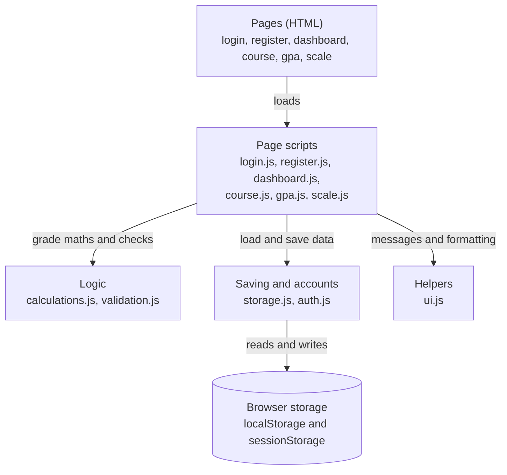
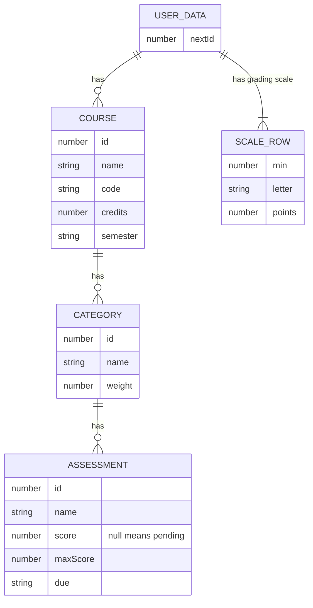
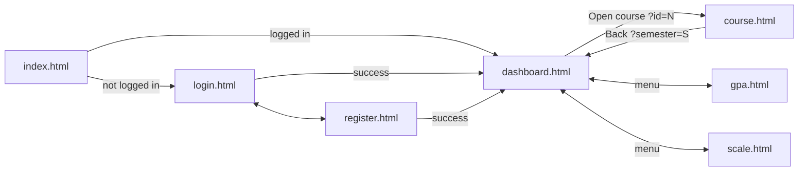
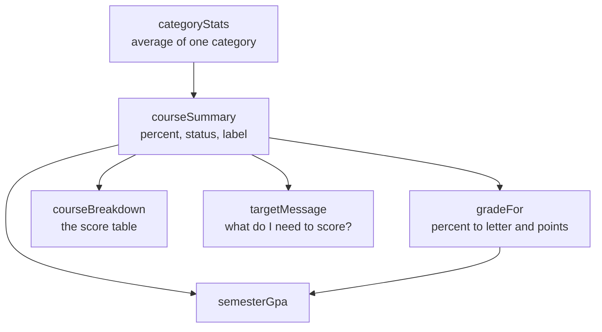
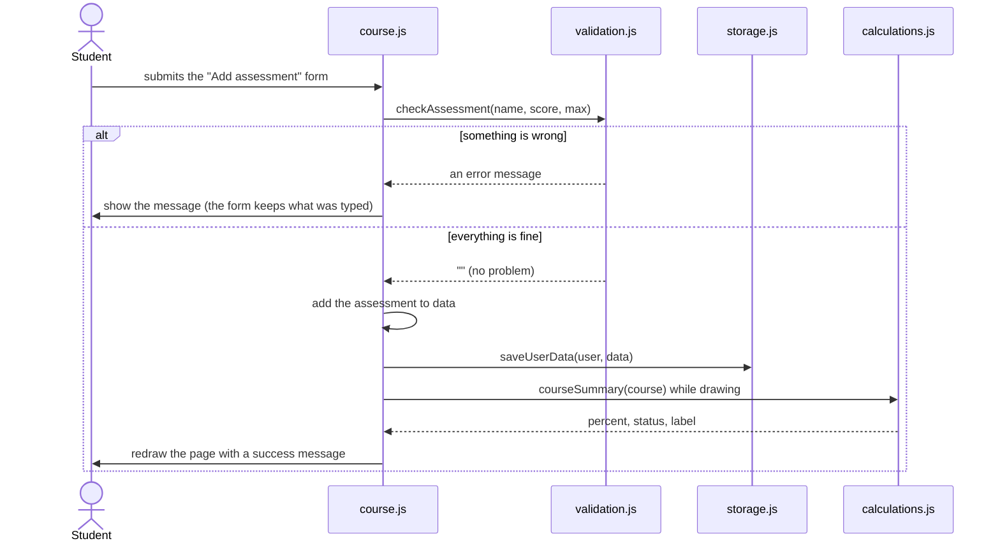
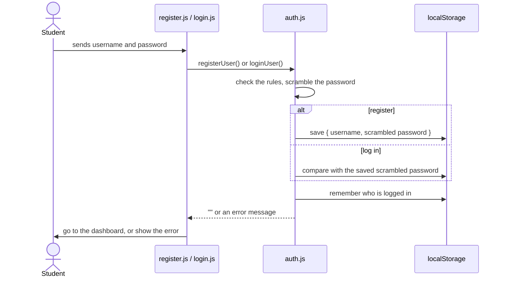

# Grade Tracker

A grade tracking and GPA projection system built with only **HTML, CSS and JavaScript**.
Students create an account, add their courses, record scores, and always see how they are
doing **so far**: a percentage, a letter grade and a GPA that grow more certain as more work is graded.

**Contents**
1. [Run it](#1-run-it)
2. [What the app does, in plain words](#2-what-the-app-does-in-plain-words)
3. [Project structure](#3-project-structure)
4. [Architecture](#4-architecture)
5. [Data](#5-data)
6. [How the grade is worked out](#6-how-the-grade-is-worked-out)
7. [Key flows](#7-key-flows)
8. [Security](#8-security)
9. [Design decisions](#9-design-decisions)
10. [Limitations](#10-limitations)
11. [Extending the project](#11-extending-the-project)
12. [Testing](#12-testing)
13. [Quiz preparation](#13-quiz-preparation)

---

## 1. Run it

No installation is needed. Open `templates/index.html` in a browser.
If the login misbehaves when opened as a plain file, run `python -m http.server` in the
project folder and open http://localhost:8000/templates/index.html.

---

## 2. What the app does, in plain words

1. A student **registers** and **logs in**.
2. They **add a course** (name, code, credit hours, semester).
3. Inside a course they add **categories**, such as Quizzes or Final exam, and give each a **weight**
   (how much of the course grade it is worth).
4. Inside a category they add **assessments**, such as Quiz 1, with the score earned and the score possible.
   An assessment with no score yet is **pending**.
5. The app shows the **grade so far** as soon as anything is graded, together with how much of the
   course has been graded. As more scores go in, "so far" becomes "projected" and then "final".
6. The **GPA page** adds up all the courses and lets the student type pretend scores to see what would happen.
7. Everything is saved in the browser, so the student finds their courses again next time they log in.

---

## 3. Project structure

```text
grade-tracker/
├── templates/               The pages (HTML)
│   ├── index.html           Sends you to the dashboard or the login page
│   ├── login.html           Login page
│   ├── register.html        Register page
│   ├── dashboard.html       Totals, add a course, a card for each course
│   ├── course.html          One course: grade, score table, categories, assessments
│   ├── gpa.html             How the GPA is worked out, and pretend scores
│   └── scale.html           The grading scale
├── css/
│   └── style.css            All the styling
└── servers/                 The JavaScript. It runs in the browser: there is no server.
    ├── ui.js                Helpers: formatting, messages, header and footer
    ├── storage.js           localStorage: saving, loading, default scale, ids
    ├── auth.js              Register, log in, log out
    ├── calculations.js      All the grade maths
    ├── validation.js        Checks what the user typed
    ├── login.js             Script for login.html
    ├── register.js          Script for register.html
    ├── dashboard.js         Script for dashboard.html
    ├── course.js            Script for course.html
    ├── gpa.js               Script for gpa.html
    └── scale.js             Script for scale.html
```

---

## 4. Architecture

Each screen is its own HTML page. The browser's `localStorage` is the database. There is no server.



Three ideas hold it together:

1. **One `data` object per page.** An action changes `data`, saves it, then redraws the page.
2. **The grade maths is separate.** `calculations.js` takes values in and gives values back. It never reads the page
   or the storage, so it is easy to test and to explain.
3. **Every user has their own data.** Everything is loaded and saved under the logged-in user's key.

### Layers

| Layer | Files | Job |
|---|---|---|
| Pages | `templates/*.html` | The empty shell: header, message box, `<main id="app">`, footer, script tags |
| Page scripts | `login.js`, `register.js`, `dashboard.js`, `course.js`, `gpa.js`, `scale.js` | Handle clicks and forms, build the page's HTML, redraw it |
| Logic | `calculations.js`, `validation.js` | Grade maths and input rules |
| Saving and accounts | `storage.js`, `auth.js` | Read and write browser storage, accounts and login |
| Helpers | `ui.js` | Formatting numbers, messages, header and footer |

### Every page script is laid out the same way

1. **Start:** `requireLogin()`, then `start()`.
2. **Variables:** `data` (the user's records) and page-only values like `semester` or `editing`.
3. **Actions:** functions called by `onclick` and `onsubmit` (add, save, delete).
4. **Drawing:** `render()` and the functions that build HTML.

### Which scripts each page loads (order matters)

The scripts are plain scripts, not modules, so they work when opened straight from a folder.
Every function is then shared by all scripts on the page, which means a file must load
**after** the files it uses.

| Page | Scripts, in order |
|---|---|
| `login.html`, `register.html` | `ui` → `storage` → `auth` → the page's own script |
| `dashboard.html`, `course.html` | `ui` → `storage` → `auth` → `calculations` → `validation` → the page's own script |
| `gpa.html` | `ui` → `storage` → `auth` → `calculations` → the page's own script |
| `scale.html` | `ui` → `storage` → `auth` → `scale` |

Page scripts all use names like `render`, `save` and `data`. That is fine because only one page script is ever loaded.

---

## 5. Data

### What is stored in the browser

| Where | Key | Holds |
|---|---|---|
| `localStorage` | `gradeTracker.users` | The accounts: `{ "sam": { username, password } }` (the password is scrambled) |
| `localStorage` | `gradeTracker.session` | Who is logged in, for example `"sam"` |
| `localStorage` | `gradeTracker.data.<name>` | One user's courses and grading scale |
| `sessionStorage` | `gradeTracker.flash` | A message to show once on the next page |

### How one user's data is shaped



```json
{
  "nextId": 8,
  "courses": [
    {
      "id": 1, "name": "Introduction to Programming", "code": "CS101",
      "credits": 3, "semester": "Fall 2026",
      "categories": [
        {
          "id": 2, "name": "Quizzes", "weight": 15,
          "assessments": [
            { "id": 3, "name": "Quiz 1", "score": 4.5,  "maxScore": 5,  "due": "" },
            { "id": 4, "name": "Quiz 2", "score": null, "maxScore": 10, "due": "2026-11-01" }
          ]
        }
      ]
    }
  ],
  "scale": [
    { "min": 80, "letter": "A", "points": 4.0 },
    { "min": 0,  "letter": "E", "points": 0.0 }
  ]
}
```

### Rules about the data

- **Courses hold categories, categories hold assessments.** Deleting a course deletes everything inside it.
- **Every record has an id** from one counter (`nextId`), so the right one is edited or deleted even if names repeat.
- **Pending means `score: null`. A score of `0` is a real score.** Whether something is "graded" or "pending" is worked out
  from the score each time, never stored, so it cannot get out of step.
- **Semester is just text** on each course. The dashboard and GPA page show one semester at a time.
- **The grading scale belongs to the user**, so every course and the GPA use the same one.
  New users start with the scale from the Course GPA Tracker spreadsheet (A at 80 and above, down to E below 50).
  The grade points are the usual 4.0 steps and should be checked against the university's policy.
- **Pretend scores are never saved.** They live in a `whatIf` object in memory on the GPA page.

### Pages and how they pass information



- **Address parameters:** `course.html?id=3` picks the course. `dashboard.html?semester=Fall` and `gpa.html?semester=Fall` pick the semester.
- **`localStorage`:** the records. Every page loads them again when it starts.
- **`sessionStorage` flash:** a message that must survive a page change, such as "Course deleted."

---

## 6. How the grade is worked out

All of this is in `calculations.js`.



### Step 1: a category

> average = points earned ÷ points possible × 100, using only graded assessments

Example: 40 out of 50 and 90 out of 100 gives 130 ÷ 150 = **86.67%**. It is not the plain average of 80% and 90%,
because the two assessments are worth different numbers of points.

### Step 2: a course

Each category adds **its average × its weight ÷ 100** to the course. For example, an average of 86.67% in a 20% category adds 17.33.

The course percentage is the sum of what the **graded** categories add, divided by the weight those categories cover.
So a student sees a percentage as soon as anything is graded, and it stays fair when only part of the course is done.

| Status | When | Shown as |
|---|---|---|
| `none` | No scores at all | "No scores yet" and no grade |
| `sofar` | Only part of the course is graded (some category has no scores, or the weights do not add up to 100%) | **Grade so far**, with "X% of the course graded" |
| `projected` | Every category has scores and the weights total 100%, but some assessments are still pending | **Projected final grade**: assumes the student keeps scoring at their current average |
| `final` | Everything is graded | **Final grade** |

The page always shows a progress bar for how much of the course weight has been graded, and a note saying what is missing.
An estimate is never labelled as an official grade.

### Step 3: the letter grade

The scale is read from the highest row down. The first row whose minimum the percentage reaches gives the letter and the grade points.

### Step 4: the semester GPA

> GPA = (credits × grade points, added up for every course) ÷ (all the credits added up)

Every course with at least one score counts, using its grade so far. A course with no scores is **left out and listed with the reason**.
It is never counted as zero. The GPA is named by how certain it is:

| Shown as | When |
|---|---|
| **GPA so far** | At least one included course is only partly graded |
| **Projected GPA** | All included courses have every category scored, but some work is pending |
| **Final GPA** | Everything included is completely graded |

### Extra: "What do I need to score?"

The course grade rises in a straight line as the pending scores go from 0% to 100%. So the app works out the grade
for 0% and for 100%, then finds where the target sits between them.

### Rules that must not be broken

1. A **pending** assessment is never counted as zero.
2. A category with **no scores** is never averaged in as zero. It is reported as not graded yet.
3. **Pretend scores** only change a calculation. They are saved only when the student chooses to.
4. The grade is always labelled: so far, projected or final.

---

## 7. Key flows

### Every action follows the same four steps

**check the input → change `data` → save → redraw the page**



### Register and log in



### Starting any private page

`requireLogin()` → `renderLayout()` → `loadUserData()` → read the address → `render()` → `showFlash()`

---

## 8. Security

This app protects against **mistakes and casual snooping**. It does **not** protect against someone using the same browser.

| Concern | How it is handled |
|---|---|
| Passwords | The password is never saved as typed. A small `scramble()` function turns it into digits, and login compares the scrambled versions. |
| Other users on the same browser | Each user's data has its own key, and every page only loads the logged-in user's key. |
| Injected HTML | All user-typed text goes through `esc()` before it is placed in a page. |
| Bad input | `validation.js` checks everything before it is saved. |
| Private pages | `requireLogin()` runs first on every private page. |

**Important:** `scramble()` is deliberately simple so it can be explained. It is **not real security**. Anyone who can open the
browser's developer tools can read and change everything stored. Real security needs a server that checks the password and keeps the data.
The register page tells students not to reuse a real password.

---

## 9. Design decisions

| Decision | Why | Cost |
|---|---|---|
| Only HTML, CSS and JavaScript | The course requires it | No server, so no accounts shared between devices |
| One page per screen | Simple, and the back button works | The header and footer are built by `ui.js` instead of being pasted into every page |
| Plain scripts, not modules | Works when opened straight from a folder | Load order matters |
| Pages built from text templates | No framework needed | The whole page is redrawn after each change |
| Beginner-level JavaScript (loops, if/else, plain functions) | Easy to read and to explain | A little longer than the shortcut versions |
| Grade shown "so far" | Students can see how far they have come | Needs a status label so it is never mistaken for a final grade |
| `null` for pending | A zero score and "no score yet" can never be confused | None |
| Simple password scrambling | Easy to explain, no special browser features | Not real security (see section 8) |

---

## 10. Limitations

- **No sync between devices.** An account exists only in the browser where it was created.
- **Clearing browser data deletes everything.** There is no export or backup yet.
- **No password reset.**
- **No version number on saved data.** Changing the shape of the data later will need a step that converts old saves.
- **Accounts made with an earlier version of this app** used a different password method and will not log in.
  Remove the `gradeTracker.users` and `gradeTracker.session` entries in the browser's storage and register again.
  Courses are kept, because they are saved under the username.
- **Existing users keep the grading scale they already had.** They can press "Restore default scale" on the Grading scale page.

---

## 11. Extending the project

**Add a page:** copy `templates/scale.html`, change the title and last script tag, write a script in `servers/` that follows the
four-part layout in section 4, and add a link in `renderLayout()` in `ui.js`.

**Add a rule or calculation:** put it in `calculations.js` or `validation.js` as a function that takes values and gives a value back.
Do not touch the page from inside it.

**Export and import data (good next step):** add two functions to `storage.js` that download and read the user's data as a file.
This removes the risk of losing everything by clearing the browser, with no server.

**Move to a real backend later:** only `auth.js` and `storage.js` change. They would call a server instead of `localStorage`.
The page scripts, `calculations.js` and `validation.js` keep working because they use the same `data` shape.

---

## 12. Testing

The grade maths can be checked without any page. Open the browser console on a page that loads `calculations.js`.

| Check | Expected |
|---|---|
| 40/50 and 90/100 in one category | Average **86.67%** |
| Four categories (20, 20, 20, 40%) with the 40% one pending | **Grade so far 78.89%**, "60% of the course graded", status so far |
| Same course with a pretend 85% on the pending one | **Projected 81.33%** |
| Same course, target 80% | Need about **81.67%** on the pending one |
| Weights total only 60%, one score of 50/100 | Grade so far **50%**, noting that weights add up to 60% |
| A course with no scores | No grade, and left out of the GPA with a reason |
| Courses of 3, 3 and 2 credits with 4.0, 3.0 and 3.5 points | GPA **(12 + 9 + 7) ÷ 8 = 3.5** |
| A score of 0 | Counts as 0, not pending |
| Score over the maximum, a negative score, weights over 100% | Rejected with a message |
| Two accounts in one browser | Neither sees the other's courses |
| Refresh, then log out and in | Courses are still there |

The app was also checked against the four courses of the Course GPA Tracker spreadsheet. The percentage and the letter matched
for all four (59.86% D+, 70.27% B, 63.26% C and 79.70% B+).

---

## 13. Quiz preparation

### Ideas used in the code, and where to find them

| Idea | Where to see it |
|---|---|
| Variables (`const`, `let`) | Everywhere. `const` never changes, `let` can. |
| Functions | `calculations.js`: each step of the grade is one function |
| `if` / `else` | `validation.js`: each check returns an error message or `""` |
| `for` loops | `totalWeight()`: adds up every category's weight |
| Arrays and objects | The data in section 5: a list of courses, each one an object |
| Events | `onclick` and `onsubmit` in the pages. `event.preventDefault()` stops the page reloading. |
| The DOM | `document.getElementById("app").innerHTML = ...` draws a page |
| `localStorage` and JSON | `storage.js`: `JSON.stringify` to save, `JSON.parse` to load |
| Template strings (backticks) | `course.js`: HTML with `${value}` filled in |
| Address parameters | `URLSearchParams` in `course.js`: reads `?id=3` |
| `null` and `0` | `score: null` means pending. `0` is a real score. |

### Questions you might be asked

- **Where is the data stored?** In `localStorage` in the browser, as JSON text, under one key for each user.
- **How does login work?** Registering saves the username and a scrambled password. Logging in scrambles what was typed and compares.
  The logged-in user is remembered in `localStorage` until Log out.
- **How do you stop one user seeing another's courses?** Every page loads `gradeTracker.data.<username>`, never anyone else's.
- **Why `null` for a pending score?** So that "not graded yet" and "scored zero" can never be confused. A pending score is skipped, never counted as 0.
- **How is a category average worked out?** Points earned ÷ points possible × 100, so a 100-point test counts for more than a 5-point quiz.
- **How is the course grade worked out?** Each category's average × its weight ÷ 100, added up, then divided by the weight that has been graded.
- **What is the difference between so far, projected and final?** So far: part of the course is graded. Projected: every category has scores but some work is pending.
  Final: everything is graded.
- **How is the GPA worked out?** Credits × grade points for each course, added up, divided by the total credits. Courses with no scores are left out, not counted as zero.
- **What happens when the student clicks Add assessment?** The form is checked, the assessment is added to `data`, `data` is saved, and the page is redrawn.
- **Why are the scripts loaded in a certain order?** They are plain scripts that share functions, so a file has to load after the files it uses.
- **What is not secure about the login?** All the data is in the browser, so anyone with access to the browser can read it, and the password scrambling is deliberately simple.
